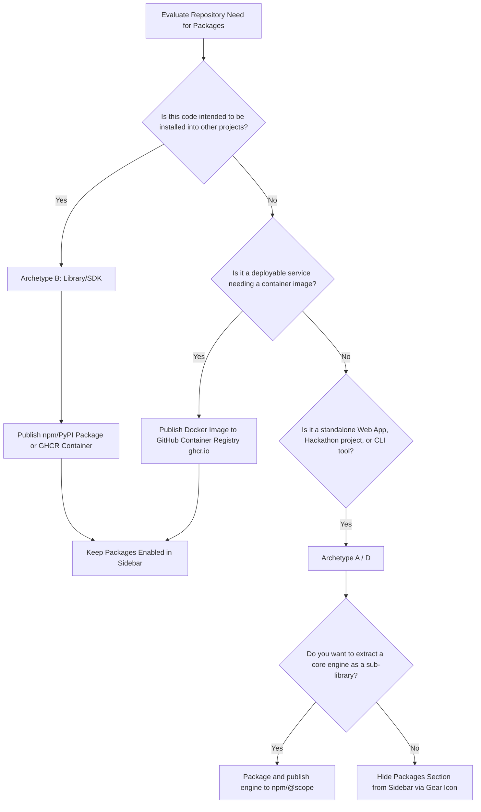

# Universal Repository Lifecycle & Packaging Framework

A comprehensive framework and standard operating procedure for auditing, organizing, and maintaining any software repository's GitHub presence, delivery channels, community health files, and release cycles.

---

## 1. Repository Archetype & Delivery Strategy

Not every repository requires the same GitHub features. Activating unused features (such as an empty **Packages** section or missing **Releases**) produces visual clutter and signals incomplete maintenance.

Use this decision matrix to classify the repository and select the appropriate delivery strategy:

| Archetype | Primary Purpose | Live URL | Releases | Packages (npm/Docker) | Recommended Sidebar Setup |
| :--- | :--- | :--- | :--- | :--- | :--- |
| **A. Standalone Web App / SPA** | Interactive frontend app for end users | Mandatory (Vercel, Netlify, Cloud Run, GitHub Pages) | Recommended (major milestones) | **Disabled** (unless containerized or engine extracted) | Show: About, Releases, Languages.<br>Hide: **Packages**. |
| **B. Reusable Library / SDK** | Code imported into other projects | Documentation site or API reference | Mandatory (every SemVer bump) | **Mandatory** (npm, PyPI, crates.io, GitHub Packages) | Show: About, Releases, **Packages**, Languages. |
| **C. Backend Service / API** | Server or microservice | API docs / Swagger endpoint | Recommended | **Recommended** (Docker image via GHCR) | Show: About, Environments, Releases, Packages. |
| **D. Hackathon / Competition Showcase** | Finished experiment with strict rules & context | Live applet or demo link | Mandatory (initial submission snapshot) | **Disabled** (unless library submission was required) | Show: About, Releases, Languages.<br>Hide: **Packages**. |
| **E. Research / Academic Artifact** | Code accompanying paper or benchmark | Paper DOI or project page | Recommended (paper release version) | Optional (data packages) | Show: About, Releases, Languages. |

---

## 2. The "Packages" Decision Engine

When evaluating the **Packages** section on GitHub (`"No packages published"`), apply this three-tier rule:



### Rule 1: When to Hide Packages (Cleanest UI)
If the project is a standalone web application, hackathon entry, or demonstration script, **turn off the Packages section**:
1. Click the **⚙️ (gear icon)** next to **About** on the top right of the repository home page.
2. In the modal under **Include in home page**, uncheck **Packages**.
3. Click **Save changes**.
> *Outcome:* Removes the placeholder link and keeps visitor focus on the working app, README, and official releases.

### Rule 2: When to Publish an npm Package
Publish an npm package when the project contains reusable algorithms, utility functions, or components that other developers can import.
- **Scope format:** `@username/package-name` (e.g. `@dharmendra-05/split-wiz`).
- **Target Registry:** npmjs.com or GitHub Packages (`npm.pkg.github.com`).
- **Prerequisites:**
  - Export entry point (`"main": "dist/index.js"` or `"module": "index.js"`).
  - Clean TypeScript declarations (`"types": "index.d.ts"`).
  - Explicit `"files"` whitelist in `package.json`.

### Rule 3: When to Publish a Docker Container (GHCR)
Publish to GitHub Container Registry (`ghcr.io/username/repo`) when:
- The app requires specific runtime environments, backend servers, or multi-service orchestration.
- Users should be able to run it with a single command (`docker run -p 3000:80 ghcr.io/username/repo:latest`).

---

## 3. GitHub "About" Sidebar Optimization

The right-hand **About** section provides discovery across GitHub search, search engines, and social cards.

### 3.1 Description Formula (Max 350 characters)
Use this structured template:
```text
[Emoji] [Identity/Type] + [Core Value Proposition] + [Built with Stack/Platform] + [Context/Event]
```

*Example for Web App / Hackathon:*
> `⚡ Zero-code expense-splitting & exact-paise debt settlement web app built with Gemini 3.8 Flash for IIT Bombay Techfest Zonals @ SAU.`

*Example for Library / SDK:*
> `📐 High-precision integer-paise financial splitting and greedy min-cash-flow debt simplification engine for JavaScript/TypeScript.`

### 3.2 Website URL Resolution Order
Always configure the **Website** field in this priority order:
1. **Live Production / Demo Deployment** (e.g., Google AI Studio app, Vercel, Netlify, Cloud Run).
2. **Project Documentation Page** (e.g., GitHub Pages, GitBook).
3. **Repository Readme Anchor** (if no external deployment exists, use `https://github.com/username/repo#readme`).

### 3.3 4-Tier Topics (Tags) Taxonomy
Select 10–18 targeted tags using this four-tier taxonomy:

1. **Domain / Problem Space:** What problem does it solve?  
   `expense-splitter`, `bill-split`, `debt-simplification`, `exact-paise`, `fintech`
2. **Core Technology Stack:** What is it built with?  
   `vanilla-javascript`, `html5`, `css3`, `web-crypto`, `pbkdf2`
3. **AI / Tooling Platform:** How was it authored or supported?  
   `google-ai-studio`, `gemini-3-8-flash`, `prompt-engineering`, `zero-code`
4. **Context / Event / Milestone:** Where was it built?  
   `hackathon`, `iit-bombay-techfest`, `south-asian-university`

---

## 4. Open-Source Community Health Standards

Every public repository should satisfy GitHub's Community Standards checklist to build trust and prevent legal ambiguity:

### 4.1 License Selection
Choose a standard OSI-approved license based on project intent:

| License | Best For | Characteristics |
| :--- | :--- | :--- |
| **MIT** | Maximum permissive reuse, web apps, hackathon projects | Highly permissive; allows commercial and private use with minimal restriction. |
| **Apache-2.0** | Enterprise utilities, libraries | Permissive, includes explicit patent grant and trademark protection. |
| **GPLv3** | Strong copyleft | Forces derivative works to remain open source under the same terms. |

### 4.2 Code of Conduct (`CODE_OF_CONDUCT.md`)
Always provide a Contributor Covenant v2.1 file containing an active, designated moderation email (`mailto:...`).

### 4.3 Documentation Hierarchy
- `README.md`: High-level presentation, origin story, architecture, quick start.
- `docs/`: In-depth specifications, challenge briefs, mathematical proofs, or API references.
- `.env.example`: Safe configuration template with zero exposed secrets.

---

## 5. Semantic Versioning & Synchronization

Follow **SemVer 2.0.0**: `vMAJOR.MINOR.PATCH`

```
  v 1 . 0 . 0
    │   │   └── PATCH: Backward-compatible bug fixes
    │   └────── MINOR: Backward-compatible new features / enhancements
    └────────── MAJOR: Breaking changes or incompatible API revisions
```

### Synchronization Protocol
Before tagging a release, ensure all internal version declarations match:
1. `package.json` -> `"version": "X.Y.Z"`
2. App runtime constants (e.g., `SCHEMA_VERSION: 'X.Y.Z'` in `app.js`)
3. Manifests (e.g., `metadata.json` or `pyproject.toml`)

---

## 6. Git Tagging & Release Workflow

### 6.1 Creating Annotated Tags
Always use annotated tags (`-a`) with descriptive metadata:

```powershell
# 1. Verify working directory is completely clean
git status --short --branch

# 2. Create the annotated release tag
git tag -a v1.0.0 -m "Release v1.0.0: Initial ZeroCode Hackathon release for IIT Bombay Techfest Zonals"

# 3. Inspect the created tag
git tag -n1 -l "v1.0.0"

# 4. Push the tag to GitHub (only with explicit authorization)
git push origin v1.0.0
```

### 6.2 Standard GitHub Release Notes Template
When publishing a release on GitHub (`/releases/new`), structure the notes with these sections:

```markdown
## ⚡ [Project Name] v[X.Y.Z]

[1-2 sentences summarizing the release milestone, context, and purpose.]

### 🏆 Milestone / Context Highlights
- [Key highlight 1: event, milestone, or major achievement]
- [Key highlight 2: architectural breakthrough or performance metric]

### ✨ What's Included / New Features
- **[Feature 1]:** [Brief description of functionality and implementation]
- **[Feature 2]:** [Brief description of functionality and implementation]
- **[Feature 3]:** [Brief description of functionality and implementation]

### 🐛 Bug Fixes & Refinements
- [Fix 1: issue addressed]
- [Fix 2: edge case handled]

### 📦 Artifacts & Documentation
- Documentation: `README.md`
- Challenge / Problem Brief: `docs/`
- License: MIT
```

---

## 7. Step-by-Step Repository Audit Runbook

Follow this runbook when auditing or updating any repository:

1. **Step 1 — Classify Archetype:** Determine if the repo is Archetype A (Web App), B (Library), C (Backend), or D (Hackathon).
2. **Step 2 — Configure Sidebar ("About"):**
   - Apply the description template (§3.1).
   - Add the live demo/documentation URL (§3.2).
   - Apply the 4-tier tag taxonomy (§3.3).
   - Check or uncheck **Releases** and **Packages** based on Archetype (§1 & §2).
3. **Step 3 — Audit Community Health:**
   - Verify `LICENSE` is present with valid copyright year and author.
   - Verify `CODE_OF_CONDUCT.md` is present with active email.
   - Verify `README.md` has functional links, badges, and accurate setup steps.
4. **Step 4 — Verify Project Manifests:**
   - Verify `package.json` / `pyproject.toml` contains clean project name, semver version, license, and repository URL.
5. **Step 5 — Create Annotated Release Tag:**
   - Create annotated Git tag `vX.Y.Z`.
   - Push commit and tag to GitHub.
6. **Step 6 — Publish GitHub Release:**
   - Use the Release Notes template (§6.2) to publish the official release.

---

## 8. Reference Implementation: Split Wiz

This repository serves as a model implementation of **Archetype D (Hackathon Showcase) & Archetype A (Client-Side Web App)**:

- **Repository:** `Dharmendra-05/Split-Wiz`
- **Archetype:** Standalone Web App / Zero-Code Hackathon Showcase
- **Sidebar Configuration:**
  - Description: `⚡ Zero-code expense-splitting & exact-paise debt settlement web app built with Gemini 3.8 Flash for IIT Bombay Techfest Zonals @ SAU.`
  - Website: `https://ai.studio/apps/1b5a65eb-84a3-4ce8-96dd-796a23671ad0`
  - Packages: **Disabled** in sidebar (pure client-side SPA, zero package dependencies)
  - Releases: **Enabled** (`v1.0.0` published)
- **License:** MIT (`LICENSE`)
- **Code of Conduct:** Contributor Covenant v2.1 (`CODE_OF_CONDUCT.md`)
- **Challenge Brief:** `docs/project_theme.txt`
